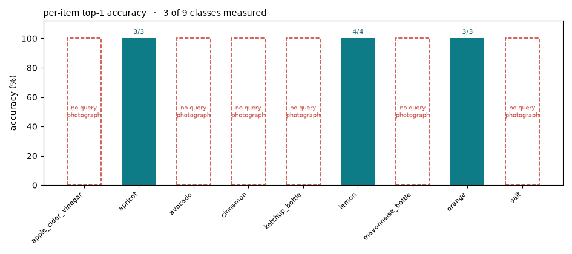

# Accessible Image Recognition


[](LICENSE)

A spoken item identifier for people who
are blind or have low vision. It finds every item in a photo, identifies each
one with a fine-tuned ResNet-18, and says the answer out loud - including how
sure it is. The first focus is **food and pantry items**, where cans, jars,
bottles and spice containers often feel alike and differ mainly by their
printed label. It does the same job as the product-scan mode in apps like
Seeing AI.

## What it does

- **Finds every item in one photo** - lay a few items on a plain, dark surface
  and take a single picture; each item is isolated and identified separately.
- **Identifies each item** with a ResNet-18 pretrained on ImageNet and adapted
  to nine pantry items: ketchup, mayonnaise, salt, cinnamon, apple cider
  vinegar, lemon, orange, apricot and avocado.
- **Speaks every result**, so no screen is needed. Point it at a folder and it
  reads out every photo in one pass.

## Designed for accessibility

The spoken output is the product, so it is designed to be honest about
uncertainty:

| Situation | What it says |
|---|---|
| confident (0.6 or above) | *"This looks like salt."* |
| not confident | *"I'm not confident about this one. My best guess is salt, but please double check."* |
| nothing found | *"I didn't detect any items in that photo. Try a plainer, darker background."* - never silence |
| every identification | ends with *"This is a computer vision prototype, not a verified identification."* |

Across the test photos, every confident answer was correct. All 9 false
detections from the cluttered shelf photos scored below 0.48 and were hedged,
as were 3 of the 10 correct answers - the tool errs toward asking the user to
double-check.

## What it demonstrates

| Area | Where it shows up |
|---|---|
| **Accessible, human-centered AI** | speech-first output; confidence-aware wording; an explicit prototype disclaimer; a failure message that tells the user what to change - [`view/speech_view.py`](view/speech_view.py) |
| **Applied ML and transfer learning** | ImageNet ResNet-18 with a frozen backbone and a new 9-class head (4,617 trainable parameters, about 20 s to train on a CPU) - [`model/classifier.py`](model/classifier.py) |
| **Computer vision** | multi-item segmentation: Otsu thresholding with a background-polarity check, dilation, and merging of items split into two contours - [`model/segmentation.py`](model/segmentation.py) |
| **ML evaluation** | a held-out test set, stated denominators, the untested classes printed on every run, and the failure case kept in the repo - [`controller/evaluation_controller.py`](controller/evaluation_controller.py) |
| **Reproducibility** | pinned seed and versions; rebuilding from the raw photos gives a byte-identical model and identical results; the data-preparation step is verified idempotent by hashing |
| **Software architecture** | model / view / controller; seven single-purpose entry points, none of which calls another - [`docs/ARCHITECTURE.md`](docs/ARCHITECTURE.md) |

## Results

| | |
|---|---|
| **Held-out accuracy** | **10 of 10** items correct across 5 photos (target: 80%). This covers 3 of the 9 items - the other 6 have no test photo yet, and every evaluation run says so |
| **Segmentation** | all 24 reference photos resolve to a single item; a three-item photo splits into exactly three crops |
| **Reproducibility** | a rebuild from the raw photos reproduces the model and the results byte for byte |
| **Known failure** | cluttered shelf photos: 4 shelves produce 9 crops, none of them a single item. Segmentation, not classification, is the limit today |

<p align="center">
  
</p>

## Quickstart

Needs Python 3. Speech uses the computer's built-in voice, so turn the volume up.

```bash
git clone https://github.com/alaratwork/Accessible-Image-Recognition.git
cd Accessible-Image-Recognition
python3 -m venv .venv && source .venv/bin/activate
pip install -r requirements.txt

python -m controller.reference_crop_controller   # raw photos -> cropped training set
python -m controller.training_controller         # trains, writes item_classifier.pth
python -m controller.evaluation_controller       # reproduces the 10/10 result
python -m controller.prediction_controller data/query_labeled/apricot+lemon+orange_1.jpeg   # speaks aloud
```

Run the programs as modules (`python -m controller.…`) from the project root.
[docs/HOW_TO_RUN.md](docs/HOW_TO_RUN.md) lists every entry point and the
gotchas.

## How it works

1. **Segment** - the photo is thresholded against its background, cleaned up
   and split into one crop per item, in reading order.
2. **Classify** - each crop goes through the fine-tuned ResNet-18, which returns
   the most likely item and its confidence.
3. **Speak** - each result is announced with wording that depends on that
   confidence.

The plain-language flow is in [diagrams/program_flow.png](diagrams/program_flow.png),
and [diagrams/architecture.png](diagrams/architecture.png) shows which program
calls which function.

## Known limitations

- **Small dataset:** 24 reference photos across 9 items, all my own. Only 3 of
  the 9 items have held-out test photos so far.
- **Needs a plain, dark surface:** cluttered scenes such as a full shelf are not
  segmented into single items.
- **One still photo at a time:** there is no live camera mode yet.

## Where it could go

- Spoken guidance while framing a photo, so someone can position items without
  needing to see the screen.
- Reading the printed label text, which is what really tells look-alike
  packages apart.
- A learned object detector instead of thresholding, to handle cluttered shelves.

## Repository layout

```
model/             segmentation, the classifier and prediction
view/              speech output (the user-facing layer) and debug plots
controller/        seven entry points: prepare data, train, evaluate, predict, experiment
data/              my own photos: reference set, held-out test photos, shelf failure cases
docs/              architecture notes, run guide, figures
diagrams/          program flow, architecture and task flow
tools/             scripts that regenerate the figures and diagrams
```

Every photo in the dataset is my own. In terms of AI use, Claude and Figma were
used to fix five major bugs and duplicate files, build the information-architecture
visuals, and refine the documentation.

MIT licensed - see [LICENSE](LICENSE). Related project:
[Image Studio](https://github.com/alaratwork/Image-Studio), a photo editor with
visual search.
